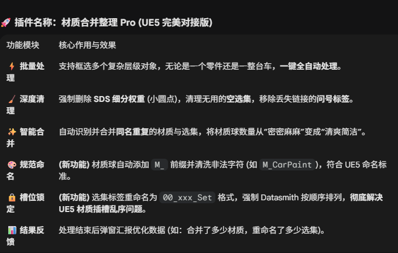

# C4D Material Workflow Tools

A small open-source toolkit for speeding up repetitive material work in **Cinema 4D**, with a focus on **Redshift PBR setup** and **material-tag cleanup for imported production assets**.

The repository currently contains two independent Cinema 4D Python plugins:

| Tool | What it does |
|---|---|
| **Redshift PBR Material Builder** | Detects common PBR texture channels, sets sensible Redshift color spaces, builds/connects a Redshift material graph, and can batch-create materials from texture folders. |
| **Material Tag Organizer** | Cleans material/selection tags, merges duplicate materials by normalized name, sorts materials, standardizes names, and rebuilds polygon-selection/material-tag assignments. |

> These tools come from real production workflows and are released here as a standalone open-source toolkit. They do not contain source code from unrelated commercial plugins.



## 1. Redshift PBR Material Builder

### Main features

- Detects common texture channels from filenames:
  - Base Color / Albedo / Diffuse
  - Ambient Occlusion
  - Roughness
  - Metalness
  - Normal / Bump
  - Displacement / Height
  - Opacity / Alpha
  - Emission
- Sets **sRGB** for color/emission textures and **Raw** for data textures.
- Connects textures to a Redshift Standard Material.
- Adds helper nodes for AO, roughness, bump/normal and displacement workflows.
- Creates a shared scale control for texture sampler nodes.
- Can scan a folder and batch-build materials when at least three recognized channel types are found for a texture set.
- Can rename the material from the detected texture-set name.
- Can assign the generated material to the active object and enable Redshift subdivision/displacement when displacement is present.

### Quick start: auto-connect an existing material

1. Create a Redshift Standard Material.
2. Add your PBR texture nodes to the material graph.
3. Make the material active in Cinema 4D.
4. Run **Redshift PBR Material Builder** and choose the auto-connect action.

The plugin scans texture sampler nodes in the active Redshift material, classifies them by filename, applies color-space settings and creates the required connections.

### Quick start: batch-create from a folder

1. Put one or more PBR texture sets in a folder.
2. Run **Redshift PBR Material Builder**.
3. Choose the folder import action.
4. The plugin groups recognized texture sets and creates Redshift materials automatically.

### Filename examples

Typical names that work well:

```text
Wood_BaseColor.png
Wood_Roughness.png
Wood_Normal.png
Wood_Metalness.png
Wood_AO.png
Wood_Displacement.exr
```

`Gloss`/`Glossiness` maps are intentionally **not** treated as Roughness automatically because they require inversion. This avoids silently building the physically opposite result.

## 2. Material Tag Organizer

Designed for imported characters, vehicles and other assets that can arrive with many material channels, selection tags and inconsistent names. The organizer works at Cinema 4D's material/tag level and is **not limited to Redshift**: it can organize tags that reference native/standard Cinema 4D materials as well as Redshift materials.

### Main features

- Processes multiple selected polygon objects.
- Removes invalid or orphaned selection/material tags when cleanup is enabled.
- Removes SDS/session-style tags handled by the current workflow.
- Merges materials that share the same normalized base name.
- Sorts document materials alphabetically.
- Standardizes material names with an `M_` prefix and safe characters.
- Rebuilds local material assignments using predictable selection names such as:

```text
00_M_CarPaint_Set
01_M_Glass_Set
02_M_Rubber_Set
```

- Shows a summary after processing.

### Important limitation

Duplicate-material merging is currently **name-based**, not shader-graph-based. The organizer does not depend on a specific renderer for tag cleanup, but it also does not compare renderer-specific shader graphs when deciding whether materials are duplicates. If two different materials intentionally use names such as `Paint`, `Paint.1` and `Paint.2`, review the scene before running merge/organize on production data. Use versioned scene files or a backup for destructive cleanup operations.

## Installation

Each tool is self-contained.

```text
plugins/
├── redshift-pbr-material-builder/
│   ├── RedshiftPBRMaterialBuilder.pyp
│   └── RedshiftPBRMaterialBuilder.png
└── material-tag-organizer/
    ├── MaterialTagOrganizer.pyp
    └── MaterialTagOrganizer.png
```

Copy the plugin folder you want into a Cinema 4D plugin location, then restart Cinema 4D.

For **Redshift PBR Material Builder**, Redshift and its node material system must be available.

## Compatibility

The tools use Cinema 4D's Python API; the PBR builder additionally uses Redshift/Maxon node APIs. API identifiers can change between Cinema 4D/Redshift releases, so compatibility may vary by version.

The command plugin IDs included here are the IDs used by the author's current local workflow. If you redistribute a modified build as a separately registered Cinema 4D plugin, use an appropriate unique plugin ID.

## Changes in the open-source release

- Added safe handling for missing material references in Material Tag Organizer.
- Added Alpha/Opacity and Emission connections to the existing-material auto-link workflow.
- Explicitly creates new PBR graphs in the Redshift node space.
- Added safer Redshift IOR-port lookup for API/version differences.
- Stopped treating Gloss/Glossiness as Roughness without inversion.
- Renamed the public tools for clearer discoverability.

See [CHANGELOG.md](CHANGELOG.md) for details.

## Roadmap

- Better UDIM handling.
- Configurable filename/channel presets.
- Optional Glossiness-to-Roughness inversion.
- More defensive Redshift version compatibility checks.
- Non-destructive/dry-run preview for material-tag cleanup.
- Additional validation before name-based material merging.

## Contributing

Bug reports, compatibility notes and pull requests are welcome. See [CONTRIBUTING.md](CONTRIBUTING.md).

## License

MIT. See [LICENSE](LICENSE).

## Disclaimer

Cinema 4D, Redshift and related product names are trademarks of their respective owners. This project is independent and is not affiliated with or endorsed by Maxon.
